<div align="center">

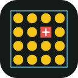

# Bird-safe gap check

**Find the gaps in a bird-safe window treatment before the job is signed off.**

A phone photo taken beside a printed calibration sheet becomes a millimetre map of the gaps<br>
between the dots on the glass. OpenCV 5 on AWS Lambda (Graviton) answers with one of three things:<br>
**pass**, **repair here**, or **retake the photo**.

[](https://github.com/Endokelp/Bird_safe_OpenCV/actions/workflows/ci.yml)


**[Try it live](https://iwny3i3fsawk2mlo3au4dcyrzi0cyepf.lambda-url.us-east-2.on.aws/)** &nbsp;·&nbsp;
**[Watch the demo](docs/media/live-demo.mp4)** &nbsp;·&nbsp;
[How it works](#how-it-works) &nbsp;·&nbsp;
[Results](#results) &nbsp;·&nbsp;
[Where it fails](#where-it-fails) &nbsp;·&nbsp;
[Run it yourself](#run-it-yourself)

<br>

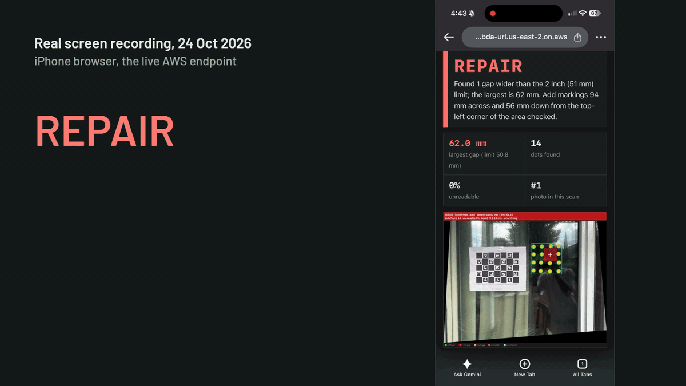

<sub>Real screen recording on a phone, 24 Oct 2026, against the live endpoint. With one dot peeled off the page reports
REPAIR, largest gap 62.0 mm. With the dot put back, the same scan reports PASS at 40.0 mm.</sub>

</div>

<br>

## Why it matters

Bird-safe window treatments work when the markings leave no gap wider than about 2 inches (50.8 mm),
the "2x2 rule" in bird-friendly glass guidance. Glass collisions kill an estimated 365 to 988 million
birds a year in the United States, almost all of them at homes and low-rise buildings
([Loss et al., The Condor, 2014](https://doi.org/10.1650/CONDOR-13-090.1)). After film or dots are
installed, one missing or misplaced marking opens a gap, and on a finished job nobody measures every
gap with a ruler.

<div align="center">
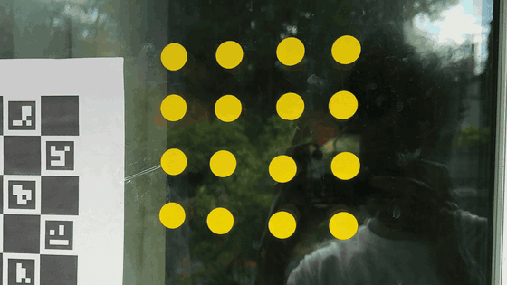
<br>
<sub>One 3/4 in dot peeled off a 4 x 4 grid at 40 mm spacing: the gap opens to about 61 mm.</sub>
</div>

<br>

## How to use it

<table>
  <tr>
    <th width="33%">1. Tape the sheet</th>
    <th width="33%">2. Take one photo</th>
    <th width="33%">3. Read the answer</th>
  </tr>
  <tr>
    <td>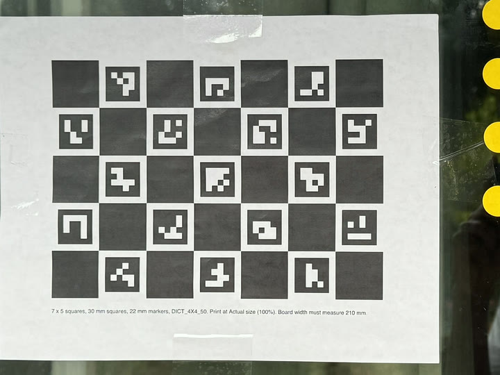</td>
    <td>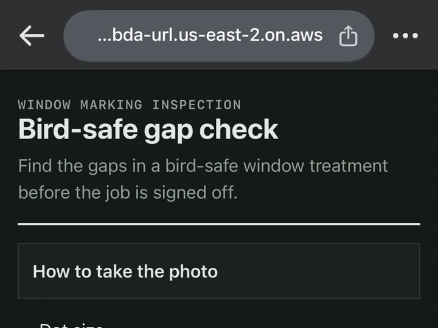</td>
    <td>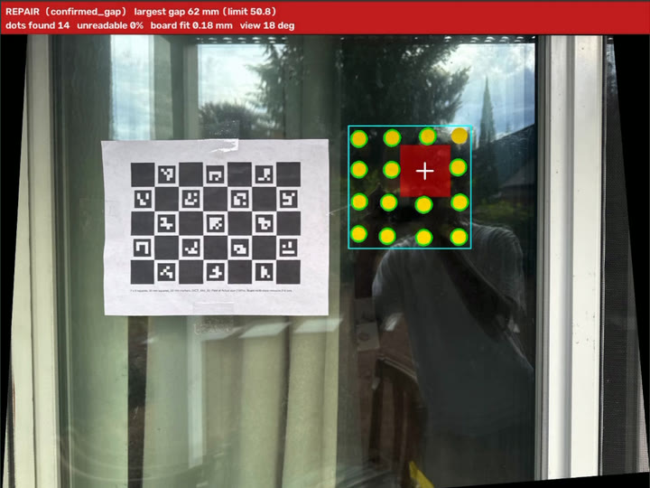</td>
  </tr>
  <tr>
    <td>Print <a href="docs/charuco-sheet.pdf">the ChArUco sheet</a> at 100% and check that the board measures 210 mm.
        Tape it flat on the same glass surface as the dots, edges parallel to the pane.</td>
    <td>Open the live page on a phone, pick the dot size, and photograph the sheet and the dots together.
        It is a web page, so there is nothing to install.</td>
    <td><b>Pass</b>, <b>repair</b> (the red square marks where to add a marking, in mm from a corner of the area
        checked), or <b>retake</b> with the reason. Add photos to the same scan to confirm a repair.</td>
  </tr>
</table>

<br>

## Demo video

<div align="center">
<a href="docs/media/live-demo.mp4">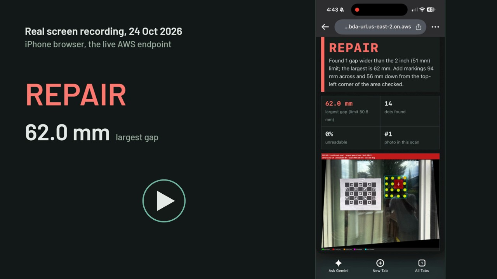</a>
<br>
<sub>39 second clip from the live phone demo: REPAIR, the dot put back, then PASS in the same scan
(<a href="docs/media/live-demo.mp4">MP4, 2.6 MB</a>).</sub>
<!-- FULL_VIDEO_LINK: replace this comment with the full 3:45 submission video link once it is on YouTube. -->
</div>

<br>

## How it works

<div align="center">

`photo` → **rectify** → **find dots** → **unreadable glass** → **empty square** → **merge photos** → **rules** → `pass · repair · retake`

</div>

<table>
  <tr>
    <td width="50%" valign="top">
      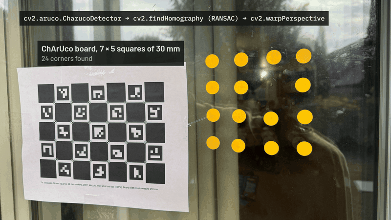
      <h3>1. Rectify to millimetres</h3>
      <code>cv2.aruco.CharucoDetector</code> finds the board corners, <code>cv2.findHomography</code> (RANSAC) fits the
      glass plane, and <code>cv2.warpPerspective</code> flattens the photo, so every pixel has a known size on the glass.
      Corner fit error on the development window: <b>0.20 mm RMS</b> over 24 corners.
      <a href="birdsafe/calib.py"><code>calib.py</code></a>
    </td>
    <td width="50%" valign="top">
      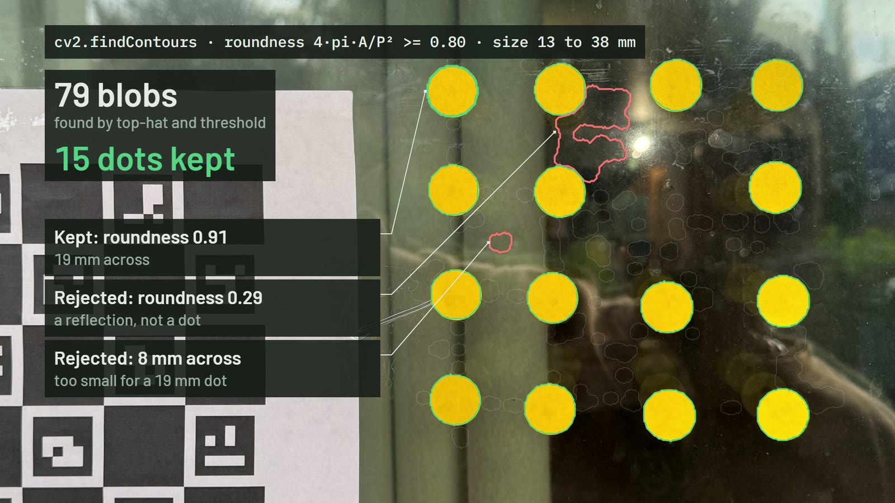
      <h3>2. Keep only real dots</h3>
      Top-hat and black-hat filters find bright and dark blobs and <code>cv2.findContours</code> measures each one.
      A blob counts as a dot only if its roundness 4πA/P² is at least <b>0.80</b> and its diameter is 0.7 to 2.0 times
      the stated dot size. Real dots measured 0.88 or more; reflection blobs 0.74 or less.
      <a href="birdsafe/markers.py"><code>markers.py</code></a>
    </td>
  </tr>
  <tr>
    <td width="50%" valign="top">
      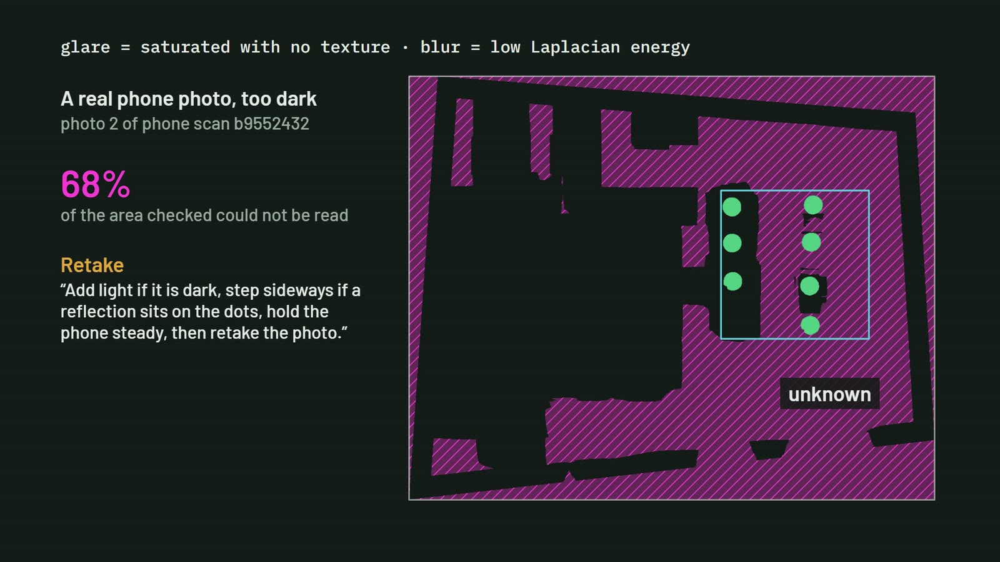
      <h3>3. Mark glass it cannot read</h3>
      Glare is saturated pixels with no texture; blur is low Laplacian energy. That glass is <b>unknown</b>: never counted
      as covered and never as a gap. Over 5% unknown, the answer is a retake aimed at the unreadable area, with advice
      such as adding light or stepping sideways out of a reflection.
      <a href="birdsafe/quality.py"><code>quality.py</code></a>
    </td>
    <td width="50%" valign="top">
      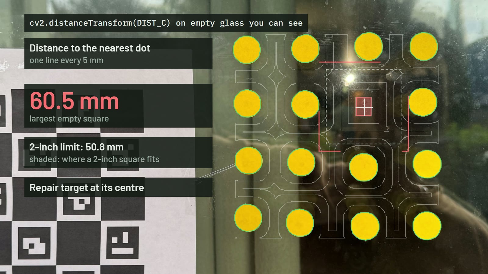
      <h3>4. Find the largest empty square</h3>
      A Chebyshev distance transform (<code>cv2.distanceTransform</code>, <code>DIST_C</code>) over readable, empty glass
      gives the largest empty square in millimetres, checked against <b>50.8 mm</b>. Each region where a 2 inch square
      fits gets a repair target at its centre.
      <a href="birdsafe/coverage.py"><code>coverage.py</code></a>
    </td>
  </tr>
  <tr>
    <td width="50%" valign="top">
      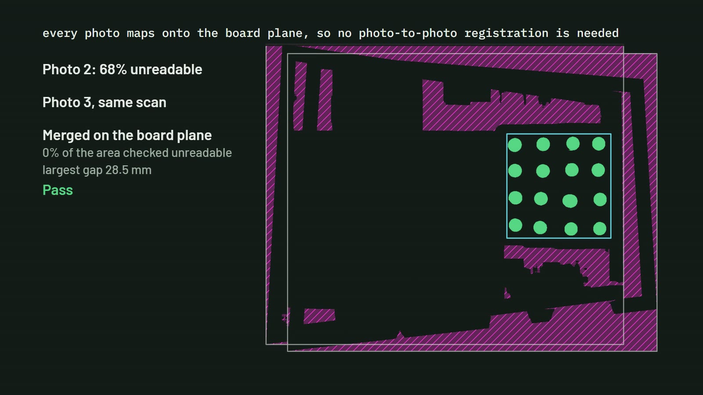
      <h3>5. Merge photos on the board plane</h3>
      Every photo maps into the board's own coordinate frame, so photos of one scan merge with no photo-to-photo
      registration. Only pixels a photo actually resolved count, so a second photo fills in what glare or darkness
      hid in the first.
      <a href="birdsafe/fusion.py"><code>fusion.py</code></a>
    </td>
    <td width="50%" valign="top">
      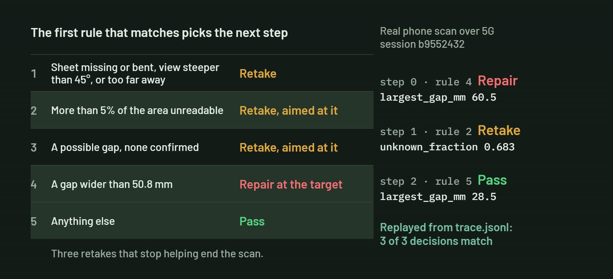
      <h3>6. Decide the next step</h3>
      A fixed, ordered rule table (no language model) turns the measurement into the next request: retake with the
      reason and where to aim, repair at a target, or pass. Each step goes into a trace that replays to the same
      decisions. Three retakes that do not improve the result end the scan.
      <a href="birdsafe/policy.py"><code>policy.py</code></a>
    </td>
  </tr>
</table>

The measurement drives what the app asks for next. A REPAIR names the spot; the next photo in the same scan
confirms it ("The repaired spot now passes."); a photo it cannot read gets a targeted retake instead of a guess.
The person holding the phone stays in charge and signs off the job.

<br>

## Architecture

<div align="center">

</div>

| Part | What it is |
| --- | --- |
| Phone page | [`web/index.html`](web/index.html), served by the same function. Scales the photo to a 2400 px JPEG in the browser, keeps the scan session id, and shows the decision with the marked-up photo. |
| Scan service | AWS Lambda, Python 3.12 on **arm64 (Graviton)**, 2048 MB, 30 s timeout, public function URL. The `opencv-python-headless` 5.0.0.93 aarch64 wheel, no container. Entry point [`birdsafe.api.handler`](birdsafe/api.py). |
| Session store | Private Amazon S3 bucket. Keeps only the fused masks (`sessions/<id>/obs.npz`) and the trace (`sessions/<id>/meta.json`), deleted after 7 days. **The photo is processed in memory and never stored.** |
| Observability | CloudWatch Logs: one JSON line per scan with the action, rule, largest gap, dots found and latency. |
| Input limits | Photos over 5.5 MB of base64 or 60 megapixels, dot sizes outside 3 to 60 mm, a dot size change inside a scan, and sessions past 8 photos get a plain 400 message. |

<br>

## Results

Every number here was measured on the code in this repository.

| Check | Result | Source |
| --- | --- | --- |
| Dot detection on synthetic panes, 6 mm and 19 mm dots | **64 of 64** found, **0** false | [`tests/test_markers.py`](tests/test_markers.py) |
| Gap check sweep: 30, 40, 45 mm grids must pass and 60, 70, 90 mm must fail, at 3 resolutions | **18 of 18** correct | [`tests/test_coverage_sweep.py`](tests/test_coverage_sweep.py) |
| Real window, one dot peeled off a 40 mm grid | **60.5 mm** measured against **61 mm** expected (2 x 40 mm minus the 19.05 mm dot); repair target **4.3 mm** from the missing dot | development photo |
| Same window, all 16 dots | PASS, largest gap 43 mm | development photo |
| Rectification | 0.20 mm RMS over 24 corners, views of 22 to 24 degrees off square | development photos |
| Live phone demo, 24 Oct 2026 | REPAIR at 62.0 mm, then PASS at 40.0 mm in the same scan | [screen recording clip](docs/media/live-demo.mp4) |
| Earlier phone scan over 5G | REPAIR 60.5 mm, then RETAKE (dark photo, 68% unreadable), then PASS 28.5 mm with 16 of 16 dots; the saved trace replays to the same 3 decisions | `birdsafe.policy.replay` |
| Endpoint latency, warm | 1.4 to 2.3 s round trip for a 2400 px photo, 0.5 to 1.6 s of it on the server, 250 MB peak memory | curl runs, CloudWatch |
| Test suite | **173 passing** | `python -m pytest` |

<table>
  <tr>
    <td width="50%">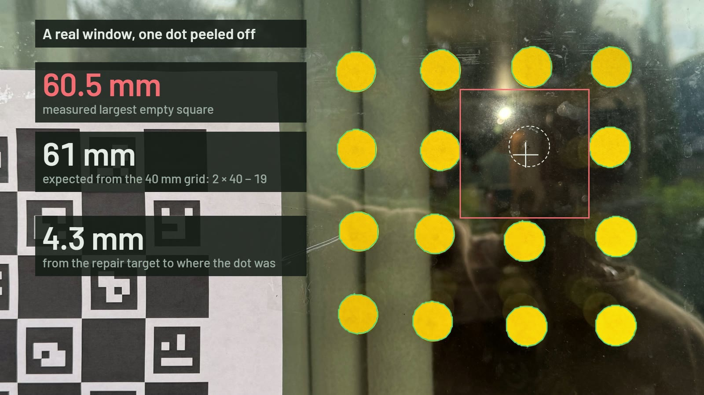</td>
    <td width="50%">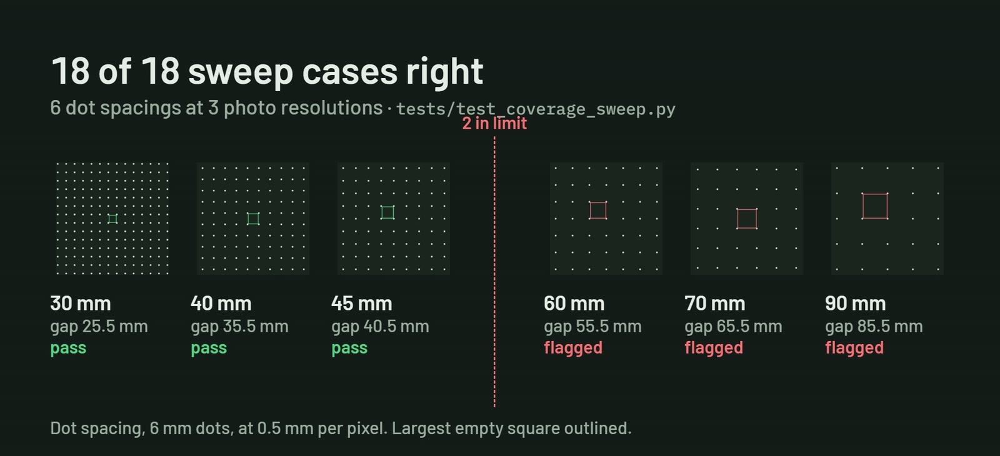</td>
  </tr>
</table>

<br>

## Where it fails

<div align="center">
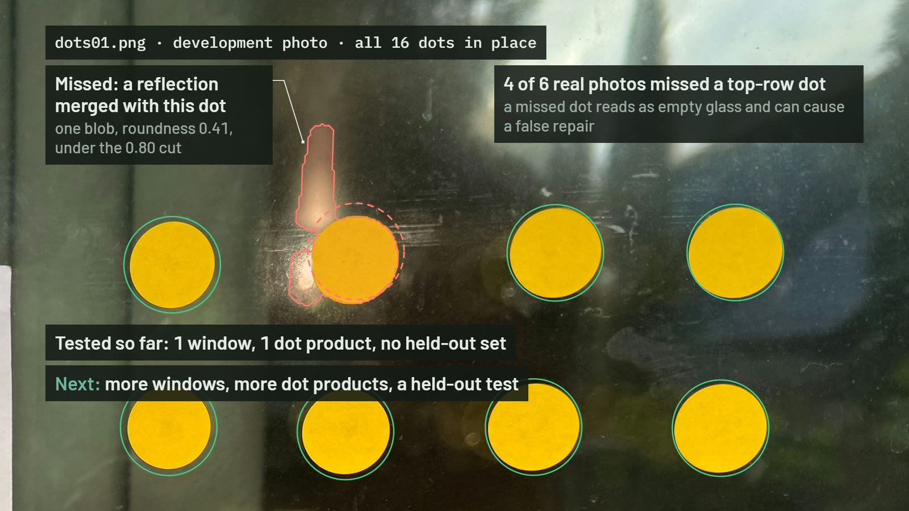
</div>

- **Top-row dots against a bright sky reflection.** In 4 of the 6 readable real photos so far, one top-row dot was
  missed (in this one the dot and a reflection merged into a blob with roundness 0.41). A missed dot reads as empty
  glass, so the error leans toward a false REPAIR that the installer can see on the marked-up photo, not toward a
  false PASS.
- **Dark photos are refused, not guessed.** 68 to 100% unreadable glass leads to a retake.
- **The area checked** is the extent of the dot group beside the sheet plus 3 mm. A missing corner dot shrinks it, and
  a pattern with gaps over about 150 mm splits so that only its largest part is checked. There is no pane outline step
  yet.
- **What a photo cannot prove:** that the markings are on the exterior surface, or that birds see them. The installer
  confirms placement and signs off.
- **Evaluation scope:** one window, one dot product (3/4 in dots), all tuning on one development session, and no
  held-out test set yet. More windows, more products and a held-out test come next.
- **Replay and sessions:** a trace replays exactly under the policy version that wrote it, and traces do not record
  that version yet. One phone per scan: two uploads to the same session at once can overwrite each other.

<br>

## Run it yourself

### On a phone

<table>
  <tr>
    <td width="70%" valign="top">
      <ol>
        <li>Print <a href="docs/charuco-sheet.pdf"><code>docs/charuco-sheet.pdf</code></a> at Actual size (100%). The board must measure 210 mm wide.</li>
        <li>Tape it flat on the glass beside the dots, edges parallel to the pane (<a href="docs/capture-protocol.md">capture protocol</a>).</li>
        <li>Open <a href="https://iwny3i3fsawk2mlo3au4dcyrzi0cyepf.lambda-url.us-east-2.on.aws/">the live page</a>, choose the dot size and take the photo. The first scan after a quiet spell can take about 10 s while Lambda starts.</li>
      </ol>
    </td>
    <td width="30%" align="center"><br><sub>Live page</sub></td>
  </tr>
</table>

### Locally

```bash
git clone https://github.com/Endokelp/Bird_safe_OpenCV.git
cd Bird_safe_OpenCV
python3.12 -m venv .venv
source .venv/bin/activate          # Windows: .venv\Scripts\activate
pip install -e ".[dev]"            # pinned: opencv-python 5.0.0.93, numpy 2.3.3
python -m pytest -q                # 173 tests
python -m tools.show_scan window.jpg result.png --dot-mm 19.05
```

`tools.show_scan` runs one scan step on your own photo and writes the marked-up result, the same drawing the phone
page shows.

### Deploy your own endpoint

With AWS CLI v2 credentials for an account you control:

```bash
PYTHON=.venv/bin/python bash deploy/deploy.sh   # Windows Git Bash: bash deploy/deploy.sh
```

The script packages the Linux arm64 wheels into a zip, creates a private S3 bucket with a 7 day expiry on `sessions/`,
an IAM role limited to that prefix, the arm64 function, and a public function URL, then prints the URL. Re-running it
updates the same resources. Region: `AWS_REGION`, default `us-east-2`.

<br>

## Repository map

| Path | Purpose |
| --- | --- |
| [`birdsafe/calib.py`](birdsafe/calib.py) | ChArUco detection, homography, metric rectification |
| [`birdsafe/markers.py`](birdsafe/markers.py) | Dot detection by physical size and roundness |
| [`birdsafe/quality.py`](birdsafe/quality.py) | Glare and blur masks (unknown glass) |
| [`birdsafe/coverage.py`](birdsafe/coverage.py) | 2x2 rule check, largest empty square, repair targets |
| [`birdsafe/fusion.py`](birdsafe/fusion.py) | Merging photos on the board plane |
| [`birdsafe/policy.py`](birdsafe/policy.py) | Rule table, decisions, trace and replay |
| [`birdsafe/scan.py`](birdsafe/scan.py) | One scan step from photo to decision |
| [`birdsafe/render.py`](birdsafe/render.py) | The marked-up photo and the area checked |
| [`birdsafe/api.py`](birdsafe/api.py) | Lambda handler, input validation, session storage |
| [`web/index.html`](web/index.html) | Phone page |
| [`deploy/deploy.sh`](deploy/deploy.sh) | Packaging and deployment to AWS |
| [`tools/`](tools) | Printable sheet generator, scan viewer, repeatability harness |
| [`tests/`](tests) | 173 tests: synthetic panes, sweep, policy, fusion, API |
| [`docs/`](docs) | Capture protocol, the printable sheet, README media |

<br>

## Responsible use

- The app measures gaps. It does not certify a window as bird-safe or code-compliant, and it does not predict
  collisions.
- Photos are processed in memory and discarded. Only the fused masks and the decision trace are kept, for 7 days.
- When sharing captures, crop to the pane and leave out people and house numbers.

## Credits

- Built by Venkata Anirudh Devireddy ([endokelp](https://github.com/Endokelp)) for the
  [OpenCV AI Competition 2026](https://opencv26.devpost.com/).
- Mortality estimate: S. R. Loss, T. Will, S. S. Loss and P. P. Marra, *The Condor* 116(1), 2014.
- Demo video music: "Effervescence" by Scott Buckley, CC BY 4.0,
  [scottbuckley.com.au](https://www.scottbuckley.com.au).
