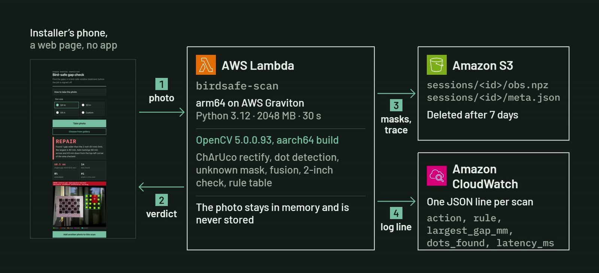

# Bird-safe gap check: technical report

Venkata Anirudh Devireddy ([Endokelp](https://github.com/Endokelp)), solo entry, OpenCV AI Competition 2026

Live app: <https://iwny3i3fsawk2mlo3au4dcyrzi0cyepf.lambda-url.us-east-2.on.aws/>

Code: <https://github.com/Endokelp/Bird_safe_OpenCV>

## 1. Problem and user

Glass collisions kill an estimated 365 to 988 million birds a year in the United States (S. R. Loss,
T. Will, S. S. Loss and P. P. Marra, "Bird-building collisions in the United States: Estimates of annual
mortality and species vulnerability", *The Condor* 116(1), 2014). Most bird-friendly glass guidance calls for markings
on the outside of the glass with no gap wider than 2 inches (50.8 mm) horizontally or vertically. This is often called the 2x2 rule.

Retrofit treatments such as applied dots are put on by hand. One dot that falls off, or one that was
never placed, opens a gap wider than the rule allows. On a finished job nobody measures every gap with a
ruler, so a missed spot can survive sign-off.

The user is the installer or inspector at the window at the end of the job. They need a fast answer to
one question: is there a gap over 2 inches in this patch of markings, and if so, where do I add a dot?
Bird-safe gap check answers it from a phone photo, in a web page, with no app to install.

## 2. System overview

The person tapes a printed ChArUco calibration sheet flat on the glass beside the dots, picks the dot
size on the phone page, and takes one photo. The server returns one of three answers:

- **PASS**: no gap wider than 2 inches in the area checked.
- **REPAIR**: a gap is wider than 2 inches, with a marked target, given in millimetres from a corner of
  the area checked, where a dot should go.
- **RETAKE**: the photo could not be measured, with the reason and, where it applies, the part of the
  glass to aim at.

After a REPAIR or a RETAKE, the next photo goes into the same scan. The scan loop is: photo, decision,
REPAIR or RETAKE, rescan, until the result is PASS or the scan stops.

The printed sheet is what makes the measurement possible. A single photo has no physical scale: a dot
far away and a dot close up can cover the same number of pixels, and an oblique view stretches one axis.
The ChArUco board has known square sizes (7 x 5 squares of 30 mm, 22 mm markers, `DICT_4X4_50`, 210 mm
wide), so its corners fix both the scale and the plane of the glass. The capture protocol asks the user
to print the sheet at 100%, check that the board measures 210 mm, and tape it on the same glass surface
as the dots, with its edges parallel to the pane, because the rule is tested along the board's axes.

## 3. Method

All image processing uses OpenCV 5.0.0.93. The pipeline works on a rectified image at 0.5 mm per pixel.

### 3.1 ChArUco rectification (`birdsafe/calib.py`)

`cv2.aruco.CharucoDetector(board).detectBoard(image)` finds the interpolated chessboard corners. The
photo is rejected as "board not found" with fewer than 6 corners, and as "board partly hidden" if all the
corners lie in one board row or one column, because a homography fitted to collinear points stretches
the axis it cannot see.

Each corner id maps to a known board position in millimetres. `cv2.findHomography(src, dst, cv2.RANSAC,
3.0)` fits the glass plane, and the reprojection RMS of the inlier corners is recorded in millimetres.
Before warping, the code maps the four photo corners through the homography and checks the sign of the
homogeneous coordinate. If a photo corner maps to infinity or behind the plane, the view is rejected as
too oblique instead of producing a broken warp. An output larger than 8000 px on a side is rejected as
too large. `cv2.warpPerspective` then flattens the photo, and a second warp of an all-white image with
`INTER_NEAREST` marks which output pixels the camera actually saw.

From the homography's Jacobian at the centre of the detected corners, the code also estimates the
native resolution on the glass and the view angle. Without camera intrinsics this is a foreshortening
estimate, not a measured pose.

### 3.2 Dot detection (`birdsafe/markers.py`)

The rectified image is converted to grey, resized to the 0.5 mm per pixel working scale, and smoothed
with a Gaussian blur (sigma 1.2 px). Dots can be lighter or darker than the glass behind them, so the
code runs two passes with an elliptical structuring element 1.6 times the dot diameter:
`cv2.MORPH_BLACKHAT` for dark dots and `cv2.MORPH_TOPHAT` for light dots. Each response goes through
`cv2.adaptiveThreshold` (Gaussian, block 1.5 times the dot diameter, C of -2) and a small opening that
cuts thin bright bridges from tape edges and reflections. The two polarities are kept separate on purpose:
on a dense grid, the glass between bright dots also gives a black-hat response, and combining the masks
merged every dot into one lattice.

`cv2.findContours` gives the candidate blobs. A blob is kept as a dot only if:

- its roundness 4πA/P² is 0.80 or more, and
- its equivalent diameter is 0.7 to 2.0 times the dot size the user picked.

The code comments record why these values were chosen: on the development window, real dots measured
0.88 or more and reflection blobs 0.74 or less. For the 19.05 mm (3/4 in) dots used in testing, the size
window is about 13 to 38 mm.

### 3.3 Unknown glass (`birdsafe/quality.py`)

Some glass in a photo cannot be read. The code marks two kinds as **unknown**:

- **Glare**: grey level 250 or more with a local standard deviation under 8, over a window twice the dot
  size. Saturated and flat means the surface is hidden by a reflection.
- **Blur and darkness**: local Laplacian energy (`cv2.Laplacian`, averaged with `cv2.blur`) under 200.
  A dark or out-of-focus area has almost no edges.

Pixels outside the area the camera saw are unknown too. Unknown glass is never counted as covered and
never as a gap. A dot detected under glare is not trusted to close a gap.

### 3.4 Largest empty square (`birdsafe/coverage.py`)

The rule is stated in horizontal and vertical terms, so the check is axis-aligned. A pane breaks the rule
wherever an axis-aligned square wider than 50.8 mm fits in readable, empty glass. The verdict erodes the
empty-glass mask with a square kernel of `floor(50.8 / 0.5) + 1` pixels, the smallest whole-pixel square
strictly wider than the rule, so a gap of exactly 2 inches passes. The border counts as non-empty, so
only squares fully inside the area checked count.

The headline number is the largest empty square in millimetres. `cv2.distanceTransform` with
`cv2.DIST_C` (chessboard distance) gives each empty pixel its distance d to the nearest dot or border.
A square of 2d - 1 pixels fits there, and one extra erosion decides whether 2d also fits. The number and
the verdict are computed on the same observed pixels, so they cannot disagree.

The code also keeps a second mask: places where a 2 inch square would fit if the unknown glass turned out
to be empty. These are **possible gaps**. Each connected region of confirmed gap
(`cv2.connectedComponentsWithStats`) becomes a **repair target** at its centroid.

### 3.5 Fusion on the board plane (`birdsafe/fusion.py`)

Every photo is rectified into the board's own coordinate frame, so photos of one scan line up without
photo-to-photo registration. The scan keeps a canvas in board millimetres. Each photo contributes its
dot mask only where it resolved the glass, and the fused unknown mask is the glass that no photo
resolved. A second photo can therefore fill in what glare or darkness hid in the first, and a dot seen
under glare cannot hide a gap that another photo saw as empty. Whole-pixel placement is off by at most
half a pixel, at most 0.25 mm at this scale.

The area checked (`birdsafe/render.py`) is the largest group of dots beside the sheet plus a 3 mm margin.
Dots are grouped by thresholding a distance transform of the dot mask at 1.5 times the rule length, so a
grid that is too sparse is still measured as one area and fails. The calibration sheet's own footprint is
left out of the check, and the PASS message says so. After a REPAIR decision, earlier photos are dropped
from the scan, because the glass they show has changed.

### 3.6 Rule table, trace and replay (`birdsafe/policy.py`)

A fixed, ordered rule table reads only numbers, never an image, and the first rule that matches picks the
next step. No language model is involved.

1. **Capture problems, RETAKE.** The board was not found or was partly hidden, the view was too oblique
   or too large, the corner fit RMS is over **1.0 mm** (sheet bent or photo blurred), the view is more
   than **45 degrees** off square, or the glass is resolved coarser than 1.5 mm per photo pixel.
2. **Unreadable glass, RETAKE aimed at it.** More than **5%** of the area checked is unknown. The message
   gives the percentage and where the unknown area is centred.
3. **Possible gap, RETAKE aimed at it.** A gap may hide under unknown glass and none is confirmed.
4. **Confirmed gap, REPAIR.** The message gives the number of gaps, the largest in millimetres, and where
   to add markings.
5. **Anything else, PASS.**

If a REPAIR came earlier in the scan, each earlier target counts as fixed only when no confirmed or
possible gap lies within 50.8 mm of it. That is when the page says "The repaired spot now passes."

A loop cap stops the scan after **3** RETAKE decisions in a row that did not help. A RETAKE helps if the unknown
fraction drops by at least 1 point or a capture problem clears.

Each step writes a trace record: the step number, the metrics, the decision and its effect on the unknown
fraction, the largest gap and the number of targets. Because the decision is a pure function of the
metrics and the history, `policy.replay` rebuilds the same decisions from a saved trace.

## 4. Agentic behaviour

The app acts in a loop, and the OpenCV result decides what it asks for next:

- **A targeted RETAKE.** When glare or darkness hides more than 5% of the area, the page asks for another
  photo and says where the unreadable part is and what to change (add light, step sideways out of a
  reflection, hold steady).
- **A REPAIR at a spot.** When a gap is confirmed, the page names the spot in millimetres and marks it on
  the photo.
- **A confirmation on rescan.** The next photo goes into the same scan and is checked against the earlier
  target.

The earlier 5G phone scan shows the loop. Step 0 was REPAIR at 60.5 mm. Step 1 was a dark photo, 68%
unreadable, so the answer was RETAKE. Step 2 was PASS at 28.5 mm with 16 of 16 dots. The saved trace
replays to the same 3 decisions.

The trace and CloudWatch make each step observable. Every photo writes one JSON log line to CloudWatch
with the action, rule, largest gap, dots found and latency. The app never marks a job as done on its
own, and the PASS message asks the person holding the phone to confirm the markings are on the outside
surface.

## 5. Architecture



| Part | Configuration |
| --- | --- |
| Phone page | `web/index.html`, served by the same function. Scales the photo to a 2400 px JPEG in the browser, keeps the scan session id, and shows the decision with the marked-up photo. |
| Scan service | AWS Lambda, Python 3.12 on arm64 (Graviton), 2048 MB, 30 s timeout, public function URL. `opencv-python-headless` 5.0.0.93 aarch64 wheel and NumPy 2.3.3 in a zip package, no container. Entry point `birdsafe.api.handler`. |
| Session store | Private Amazon S3 bucket with public access blocked. Keeps only the fused masks (`sessions/<id>/obs.npz`) and the trace (`sessions/<id>/meta.json`). A lifecycle rule deletes them after 7 days. |
| Observability | Amazon CloudWatch Logs, one JSON line per photo. |
| Input limits | A plain 400 message for a photo over 5.5 MB of base64, an image over 60 megapixels (`OPENCV_IO_MAX_IMAGE_PIXELS`), a dot size outside 3 to 60 mm, a dot size change inside a scan, a session past 8 photos, or a malformed session id. |

The photo is decoded in memory with `cv2.imdecode`, processed, and discarded. Only the masks and trace
are saved.

`deploy/deploy.sh` builds the package and deploys it. It downloads the Linux arm64 wheels, zips the code,
creates the private bucket with the 7 day expiry on `sessions/`, creates an IAM role limited to that
prefix, creates or updates the arm64 function, and adds the public function URL. Re-running it updates
the same resources.

## 6. Evaluation

Every number below was measured on this code.

| Check | Result | Source |
| --- | --- | --- |
| Synthetic dot detection, 6 mm and 19.05 mm dots | 64 of 64 found, 0 false | `tests/test_markers.py` |
| Gap check sweep: 30, 40 and 45 mm grids must pass, 60, 70 and 90 mm grids must be flagged, at 3 resolutions (0.25, 0.5 and 1.0 mm per pixel) | 18 of 18 correct | `tests/test_coverage_sweep.py` |
| Real window, one dot removed from a 40 mm grid of 19.05 mm dots | 60.5 mm measured against 61 mm expected (2 x 40 mm minus the 19.05 mm dot); repair target 4.3 mm from the missing dot | development photo |
| Same window, all 16 dots | PASS at 43 mm | development photo |
| Rectification | 0.20 mm RMS over 24 ChArUco corners, views estimated at 22 to 24 degrees off square | development photos |
| Live phone demo, 24 Oct 2026 | REPAIR at 62.0 mm (14 dots found), then PASS at 40.0 mm (15 dots found) in the same scan, "The repaired spot now passes." | phone screen recording |
| Earlier phone scan over 5G | REPAIR 60.5 mm, then RETAKE (dark photo, 68% unreadable), then PASS 28.5 mm with 16 of 16 dots; the saved trace replays to the same 3 decisions | saved trace, `birdsafe.policy.replay` |
| Warm endpoint | 1.4 to 2.3 s round trip for a 2400 px photo, 0.5 to 1.6 s of it on the server, 250 MB peak memory | curl runs, CloudWatch |
| Automated tests | 173 pass | `python -m pytest` |

Continuous integration runs on every push: `ruff check`, the test suite, and a check that the installed
OpenCV version starts with 5.

The latency figures describe this one deployment, measured with curl and read from CloudWatch. They are not a benchmark. No
comparison against x86 or other hardware was run.

Before release, a code review I did found two paths to a false PASS and missing input limits.
The first false PASS path was a grid too sparse to group as one area. The second was an unreadable repair
spot being called fixed. All three were fixed with tests, and the real photos and the phone trace kept
their decisions.

## 7. Failure cases and limitations

- **Top-row dots against a bright sky reflection.** In 4 of the 6 readable real photos, one top-row dot
  was missed. In the photo shown in the README, the dot and a reflection merged into one blob with
  roundness 0.41, under the 0.80 cut. In the live demo, the top-right dot was not ringed in either photo.
  A missed dot reads as empty glass, so the error makes a gap look larger, never smaller, and the false
  REPAIR shows on the photo.
- **Dark photos.** A dark photo gets a RETAKE with the reason.
- **The area checked** is the dot group beside the sheet plus 3 mm. A missing corner dot shrinks it, and a
  pattern with gaps over about 150 mm splits, so only its largest part is checked. There is no pane
  outline step yet.
- **What a photo cannot prove.** The app does not show that the markings are on the exterior surface, or
  that birds see them. The installer confirms placement.
- **Evaluation scope.** One window, one dot product (3/4 in dots), all tuning in one development session,
  and no held-out test set.
- **Replay.** A trace replays exactly under the policy version that wrote it, and traces do not record
  that version yet.
- **Sessions.** One phone per scan. Two uploads to the same session at the same time can overwrite each
  other.
- **The rule is axis-aligned**, as the 2x2 rule is stated. A gap that is only wide on the diagonal is not
  reported.

## 8. Responsible use and privacy

- The app measures gaps. It does not certify a window as bird-safe or code-compliant, and it does not
  predict collisions.
- Photos are processed in memory and never stored. Only the fused masks and the decision trace are kept,
  in a private bucket, and they are deleted after 7 days.
- A person confirms that the markings are on the exterior surface and signs off the job. The PASS message
  says this, and it says that the area under the sheet was not checked.
- The capture protocol asks users to frame the pane and leave out people, faces, house numbers and
  addresses.

## 9. Reproducibility

Versions are pinned in `pyproject.toml`: `opencv-python` 5.0.0.93 and NumPy 2.3.3 on Python 3.12, with
pytest 8.4.2 and ruff 0.14.0 for development. The Lambda package uses the matching
`opencv-python-headless` 5.0.0.93 aarch64 wheel.

```bash
git clone https://github.com/Endokelp/Bird_safe_OpenCV.git
cd Bird_safe_OpenCV
python3.12 -m venv .venv
source .venv/bin/activate          # Windows: .venv\Scripts\activate
pip install -e ".[dev]"
python -m pytest -q                # 173 tests
python -m tools.show_scan window.jpg result.png --dot-mm 19.05
```

`tools.show_scan` runs one scan step on a photo and writes the same marked-up result the phone page
shows. The synthetic panes used in the tests come from `birdsafe/synth.py`, so the detection and sweep
numbers rebuild from the repository alone. The calibration sheet is `docs/charuco-sheet.pdf`, made by
`tools/charuco_sheet.py`. The capture protocol is in `docs/capture-protocol.md`. To deploy a copy with
AWS CLI v2 credentials: `PYTHON=.venv/bin/python bash deploy/deploy.sh`.

The development photos are not in the repository, because captures are kept out of it for privacy.

## 10. Next steps

- Test more windows, under different light and backgrounds.
- Test more dot products: other sizes, colours and patterns.
- Collect a held-out test set and report results only on it.
- Add a pane outline step on the phone, so the area checked is the pane and not the dot group.
- Record the policy version in each trace, so old traces replay under the rules that wrote them.
